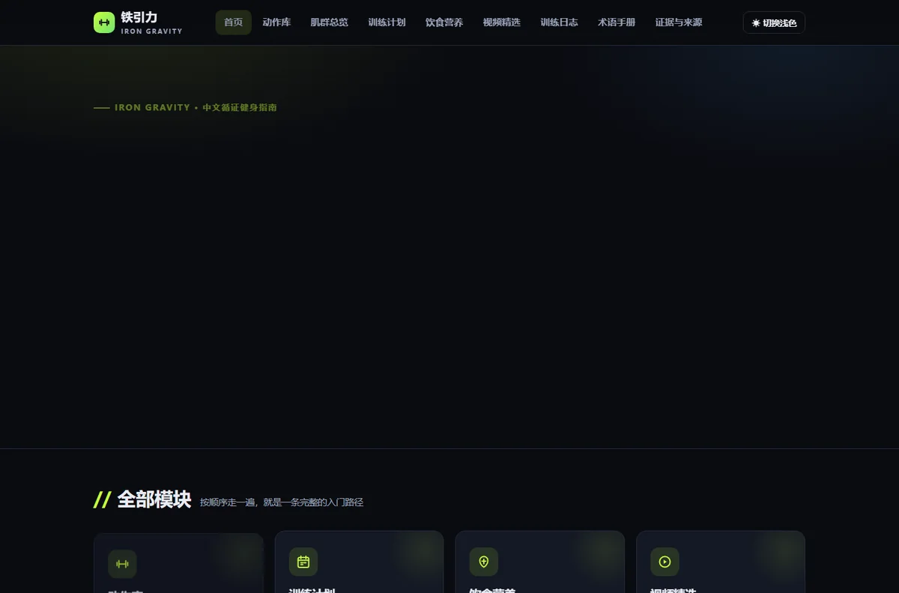
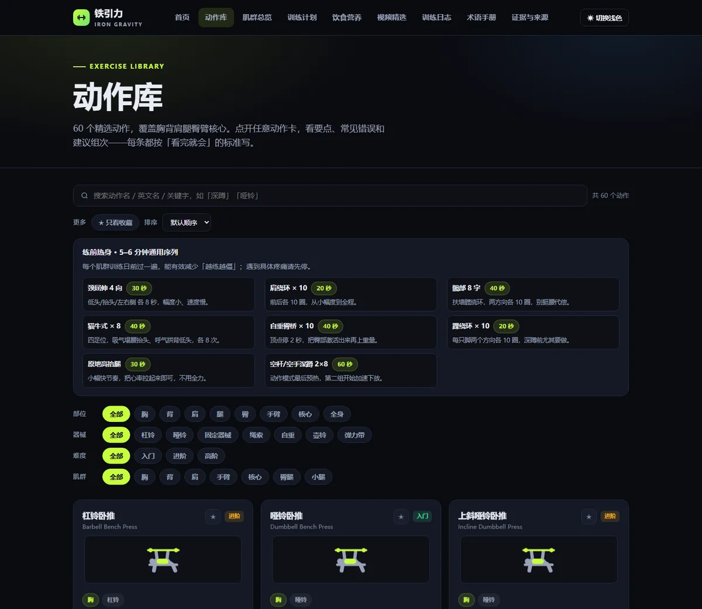

# 铁引力 · IRON GRAVITY

中文循证健身指南网站：**动作库 + 训练计划 + 饮食营养 + 创作者视频精选 + 训练日志 + 证据与来源**。
纯静态、零运行时依赖、零 CDN、**双击 `index.html` 即用**（离线可用）；带一个最小构建层与可移植的自动化门禁。

> **仓库结构**：整个仓库（含 `.git` 历史、`.github`、本 README、LICENSE）都装在 `iron gravity/` 这一个文件夹里。
> 外层 `D:\健身\` 只是容器（放一份说明 + 这个文件夹），项目可以整体打包搬走。仓库根即本目录，所以下面的所有路径都相对这里。

<p align="center">
  
  
</p>
<p align="center">
  
</p>

> 由 Hermes 于 2026-10-15 起自主调研、搭建并持续迭代（v1 → v17）。
> 全量文件索引见 [docs/INDEX.md](docs/INDEX.md)，评审修复台账见 [docs/REVIEW-FIXES.md](docs/REVIEW-FIXES.md)，调研与方案见 [docs/PLAN.md](docs/PLAN.md)。

## 怎么打开

1. **双击 `index.html`** —— 双击即用，不需要任何服务（数据全部内嵌为 JS）。
2. **双击 `serve.cmd`**（需要 Node）—— 启动本地服务并自动开浏览器（http://localhost:8642/）。走 http 时 Service Worker 生效，可「安装到桌面」并真正离线打开（`file://` 下浏览器不允许注册 SW，会自动跳过）。

> 联网时才能站内播放 B站/YouTube、跳转抖音/小红书；不联网也能浏览全部文字内容。

## 页面（10 个）

| 页面 | 说明 | 可用 URL 参数 |
|---|---|---|
| `index.html` | 首页：数据统计、今日动作、本周打卡、模块入口 | — |
| `exercises.html` | 动作库：60 个动作、四行筛选（部位/器械/难度/肌群）、搜索、收藏、排序、练前热身序列 | `?muscle=胸`、`?q=`、`?ex=`、`?sort=` |
| `muscles.html` | **肌群总览**：7 个肌群族各一张肌群级解剖图 + 该族动作清单 | `?fam=背`、`#mg-背` |
| `plans.html` | 6 套训练计划 + 「我的课表」克隆编辑器 + 打卡条 + 打印 | `#<plan-id>` |
| `nutrition.html` | TDEE 计算器、宏量分配、30 种食物速查、一日食谱生成器、补剂证据等级 | — |
| `videos.html` | 四平台创作者精选（B站站内播放，其余只链不搬） | — |
| `log.html` | 训练日志：逐组记录（**自动提示上次重量、一键沿用**）、1RM 估算、**组间休息计时器**、周容量核算（按主目标肌群）、体测、月历、趋势图、打印周报、JSON 备份（含自定义课表与体测） | `?plan=&day=` |
| `glossary.html` | 31 条术语（7 类筛选）+ 12 条新手 FAQ | — |
| `evidence.html` | **证据与来源**：8 条关键主张 × 11 篇文献（PMID 可点开核对）、A/B/C 证据等级口径、明确列出「哪些内容不是循证的」 | `#claim-volume` 等锚点 |
| `detail.html` | 动作独立详情页：说明牌图示、要点/错误/组次、**注意人群 / 退阶路径 / 教学视频（60/60 全覆盖）**、替代动作、同肌群推荐、导出 SVG | `?id=`、`?panel=atlas\|part`、`?placard=0`、`?wipe=1` |

## 证据体系

站内出现的每个「可执行数字」都挂在可核对的文献上，并标注等级：

| 等级 | 含义 |
|---|---|
| **A** | 有系统综述 / 荟萃分析或权威机构立场声明直接支持 |
| **B** | 有文献支持，但结论需从邻近人群或间接指标推导 |
| **C** | 教练共识 / 生物力学常识，没有直接对照研究 |

覆盖的 8 条主张：每周容量 10–20 组（A）、频率 ≥2 次（B）、复合动作留 1–3 RIR（B）、蛋白 1.6–2.2 g/kg（A）、减脂 0.5–1%/周（B）、肌酸 3–5 g/天（A）、**可控范围内做全幅度（A）**、**负荷下腰椎中立 / 髋铰链（B）**。
动作级还有三层：60 个动作各一条「注意人群」（一般性训练提示，非医学诊断）、23 个动作的**退阶路径**（做不动时先退一步，每一级都能点进去看要点）、以及 **60/60 的动作教学视频**（YouTube，每条都过 oEmbed 核验：200 = 存在且可嵌入，标题与频道名直接取自 oEmbed 返回）。动作技术细节其余部分明确标为 C 级，不逐条冒充循证。
文献的标题、期刊、卷期页码均通过 NCBI E-utilities 按 PMID 取回后写入，未凭记忆填写。

## 动作图示：三层，全部可回退

| 层 | 内容 | 开关 |
|---|---|---|
| ① **肌群级解剖图（默认）** | 89 个解剖区域（前 40 / 后 49），目标肌群亮红 `#ff2d2d`、参与肌群暗红 `#b23a30`；数据源自 Apache-2.0 的 `@emmorts/body-muscles v2.1.1`，已固化为仓库内静态文件 | `?panel=part` 回退部位级 |
| ② **动作帧说明牌** | 23 个自绘模板覆盖 60/60 动作（起始 / 完成双帧，含关节参考弧）；`burpee` 因多相位无法用两帧忠实表达，回退剪影 | `?placard=0` 关闭本层 |
| ③ **剪影小人** | 部位级剪影 + 目标肌群高亮，作为最终兜底 | 始终可用 |

## 隐私

所有个人数据（训练日志、收藏、饮食目标、体测、自定义课表、主题）**只存在你自己的浏览器 localStorage**，不上传任何服务器。
「导出 JSON 备份」会打包 **训练记录 + 收藏 + 饮食目标 + 自定义课表 + 体测记录**（旧版备份只有前四项，导入仍向后兼容）。
`file://` 下若浏览器禁用本地存储，页面顶部会提示改用 `serve.cmd`。

## 目录结构

```
D:\健身\iron gravity\
├─ index.html … evidence.html         # 10 个页面（head/nav/footer 由构建层生成）
├─ serve.cmd                          # 一键启动本地服务器（Node）
├─ sw.js                              # Service Worker（页面 network-first / 资源 stale-while-revalidate）
├─ robots.txt / sitemap.xml           # 部署用（用 set-domain.mjs 一键换域名）
├─ package.json                       # npm scripts（无运行时依赖，仅 Node ≥20）
├─ CHANGELOG.md                       # 版本变更记录（新增 / 变更 / 修复）
├─ LICENSE                            # 代码：MIT（纯文本，GitHub 可识别）
├─ LICENSE-CONTENT.md                 # 文字内容 CC BY-NC 4.0 + 第三方资源清单
├─ pages.config.json                  # 每页的 title/description/canonical/页脚第三列
├─ partials/                          # 构建源：nav.part.html / footer.part.html（片段，非页面）
├─ .github/workflows/verify.yml       # CI：构建一致性 + 回归 + 冒烟 + axe；每月外链复检
├─ assets/
│  ├─ css/style.css                   # 全部样式（双主题 + 打印 + 图示配色，单文件）
│  ├─ img/                            # favicon + 192/512 图标
│  └─ js/
│     ├─ data-exercises-a~f.js        # 60 个动作
│     ├─ data-plans-a~d.js            # 6 套训练计划
│     ├─ data-nutrition-a~b.js        # 饮食（原则/食物/餐单/补剂）
│     ├─ data-videos-a~d.js           # 创作者与视频（26 位）
│     ├─ data-glossary-a~b.js         # 术语 + FAQ
│     ├─ data-evidence.js             # 8 条主张 + 11 篇文献 + 60 注意人群 + 23 退阶 + 60 动作→视频
│     ├─ calc.js                      # 纯函数（BMR/宏量/1RM/周起始/容量），app.js 与单测共用
│     ├─ data-warmup.js / data-portions.js
│     ├─ anatomy-atlas.js             # 89 区域解剖路径数据（41KB，Apache-2.0 衍生）
│     ├─ data-muscles-map.js          # 动作 → 肌群 id 映射 + 次要肌群 + 中文名
│     ├─ ex-art.js                    # 剪影层（兜底）
│     ├─ ex-art-placard.js            # 动作帧模板（23 个；共享件 head/limb/pad/stack/pulley/cable/plate2/foot/arc）
│     ├─ ex-art-atlas.js              # 肌群级解剖渲染器
│     └─ app.js                       # 全部交互逻辑
├─ tools/                             # 全部为「可复跑」脚本，不参与站点加载
│  ├─ check-all.mjs                   # 一键回归（纯 Node，跨平台；不依赖 bash / Python）
│  ├─ build-pages.mjs                 # 构建层：nav/head/footer 同步进 10 页（幂等，--check 供 CI）
│  ├─ smoke.html                      # 端到端冒烟（iframe 驱动真实页面，100 项断言）
│  ├─ a11y-audit.mjs / a11y-run.html  # 无障碍实测：axe-core × 10 页 WCAG 2.1 A/AA（缺库自动下载）
│  ├─ validate.mjs                    # 数据自检（计数 + 引用完整性 + 证据/注意人群覆盖）
│  ├─ selftest.mjs                    # 本地服务器逐页自测（18 个目标）
│  ├─ check-links.mjs                 # 外链复检（限流串行复核）+ 站内坏链（跳过脚本块）
│  ├─ set-domain.mjs                  # 部署：一键替换域名（canonical / og:image / sitemap / robots）
│  ├─ check-media.mjs                 # 媒体验证：61 条视频走 oEmbed、11 篇文献走 NCBI esummary
│  ├─ unit-tests.mjs                  # 纯函数单元测试（27 项，node:assert，零框架）
│  ├─ lib/chrome.mjs                  # 跨平台 Chrome 定位 + headless DOM 导出
│  ├─ check-all.sh                    # 兼容入口（内部转 check-all.mjs）
│  ├─ audit-css-a11y.mjs              # CSS 变量一致性 / 未使用类 / 逐页无障碍静态审计
│  ├─ fix-review-p2.mjs               # og·apple meta / defer / manifest 相对路径（幂等）
│  ├─ fix-a11y-v12.mjs                # 跳过链接 / aria-* / 内联样式归一（幂等）
│  ├─ serve.mjs                       # 零依赖本地服务器
│  └─ art/                            # 图示工具链（帧模板复核页、几何自检、拼图/切图脚本等）
└─ docs/
   ├─ INDEX.md                        # 全仓文件分类索引
   ├─ PLAN.md                         # 调研 · 方案 · 逐版自审
   ├─ REVIEW-FIXES.md                 # 评审台账（外部 70 分 / 自查 v14 / 外评 80 分 v15）
   ├─ ATTRIBUTION.md                  # 许可台账（含 AI 草稿层移除记录）
   ├─ licenses/body-muscles-LICENSE.txt
   ├─ legacy/                         # 退役的图示样板页（v5–v7，不参与发布）
   └─ screenshots/                    # 过程留档（MANIFEST.md 为清单）
```

## 构建层（改导航只需要改一处）

根目录的 HTML **始终是完整、可双击打开的成品**——脚本不搬去 `src/`/`dist/`，只重写每个页面里的三段：

```
<meta charset="utf-8"> … </head>      ← title / description / canonical / og / icon / manifest
<nav class="nav"> … </nav>
<footer> … </footer>
```

```bash
npm run build              # 写入（幂等，重复跑无副作用）
npm run check:build        # 只校验是否与 partials 一致（CI 用，不一致退出码 1）
```

改导航：编辑 `partials/nav.part.html` → `npm run build`。改标题/描述/页脚第三列：编辑 `pages.config.json` → `npm run build`。

## 回归与自检

```bash
npm test                   # 等价于 node tools/check-all.mjs（11 项检查全跑）
npm run test:offline       # 跳过联网外链（PR 门禁用）
npm run a11y               # 只跑无障碍实测（axe-core，10 页 × 深/浅 2 主题 = 20 组合）
npm run check:build        # 只校验页面是否与 partials/config 同步
node tools/unit-tests.mjs  # 只跑纯函数单元测试（27 项）
node tools/check-media.mjs  # 只跑媒体验证（61 条视频 oEmbed + 11 篇 PMID）
bash tools/check-all.sh review   # 重出图示复核图
```

`check-all.mjs` 依次跑：语法（42 文件）→ 纯函数单元测试（27 项）→ 构建一致性 → 几何 → 肌群映射 → 服务器自测（18 目标）→ 数据校验 → 外链 64 条 → **媒体验证（72 条）** → 端到端冒烟 → 无障碍 axe（每页深色与浅色各跑一遍）。
Chrome 路径自动探测（`$CHROME` → 各平台常见路径 → PATH），Windows / macOS / Linux 均可复跑；不需要 Git Bash，不需要 Python。

当前基线（2026-10-18，v17）：

```
✓ 语法 42 个文件全过        ✓ 单元测试 27 项全过
✓ 构建一致性（10 页与 partials 同步）  ✓ 几何自检  ✓ 肌群映射 PASS
✓ 服务器自测 18 目标        ✓ 数据校验（60 动作 / 8 主张 / 11 文献 / 60 注意人群 / 23 退阶 / 60 视频）
✓ 外链 64 · 失败 0 · 站内坏链 0（海外 CI 上 B 站会回 412 风控，单列不计失败）
✓ 媒体验证 72 条（视频 61 oEmbed + 文献 11 PMID）· 失败 0
✓ 端到端冒烟 112 项，失败 0  ✓ 无障碍 axe 20 组合（10 页 × 深/浅 2 主题）violations = 0
合计 11 项检查 · 失败 0 项 · 全绿
```

## 内容怎么维护

- **加/改动作**：编辑 `assets/js/data-exercises-*.js`（字段 `id/name/en/parts/equip/level/tips/errs/dose/alt`），`id` 用于与计划互链。
- **加/改「注意人群」**：编辑 `assets/js/data-evidence.js` 的 `IG_CAUTION`（缺一条 `validate.mjs` 会报错）。
- **加/改证据主张**：编辑 `IG_EVIDENCE.claims` / `IG_EVIDENCE.refs`；新文献请先按 PMID 到 PubMed 核对标题与卷期页码再写入。
- **给动作配肌群**：在 `assets/js/data-muscles-map.js` 的 `IG_MUSCLES_MAP` 里按解剖区 id 精确高亮；次要肌群进 `IG_MUSCLES_SEC`（会自动从目标肌群中剔除）。
- **加/改计划**：编辑 `assets/js/data-plans-*.js`，`schedule[].items[].ex` 填动作 id。
- **加/改视频**：编辑 `assets/js/data-videos-*.js`，B站填 `bvid` 可站内播放。
- **改样式**：`assets/css/style.css` 单文件，按 `v2…v14` 追加块组织；配色一律走 CSS 变量（深浅双主题）。
- **周容量口径**：「近 8 周肌群容量」按**动作主目标肌群**（`IG_MUSCLES_MAP` 第一个基名）计数，不用部位——腿/背这类多关节部位会把股四+腘绳+臀合并，套「每肌群 10–20 组」阈值必然虚高。

## 部署（若要放到网上）

```bash
node tools/set-domain.mjs https://your-domain.com   # 一次性：canonical / og:image / sitemap / robots
```

- **排除** `docs/`、`tools/`、`partials/`、`.github/`（robots.txt 已 Disallow 前两者；静态托管另加忽略清单）；站点本体实测 **约 460KB**（10 个 HTML + assets）。
- `og:image` 由构建层写成绝对 URL（`set-domain` 后自动指向新域名）；建议换成 1200×630 的独立分享图。
- Service Worker 只在 http(s) 下注册，部署后「安装到桌面」可离线打开；`sw.js` 里的 `VERSION` 由 `npm run build` 从 `package.json` 的版本号自动同步（不用手改，忘了也不会出现「改了站点但缓存还是旧的」）。
- `.github/workflows/verify.yml` 在 push/PR 跑门禁，并在**每月 1 日**自动复检外链（链接腐烂是静态站最大的长期风险）。

## 版本与发布

- 当前版本 **1.0.0**：`package.json`、`sw.js` 的 `VERSION`、git tag 三处一致。
  1.0.0 之前是 5 轮内部迭代（内部计数 v14 → v18），记录留在 `CHANGELOG.md` 的「开发期迭代记录」里。
- **日常维护流程（改哪里 → 跑什么 → 怎么发版）见 [`docs/MAINTENANCE.md`](docs/MAINTENANCE.md)。**
- 变更记录见 [`CHANGELOG.md`](CHANGELOG.md)（按版本列「新增 / 变更 / 修复」）。
- 缓存失效是全自动的：`sw.js` 的 `VERSION` 由 `npm run build` 从 `package.json` 注入，发版只改一处。
- 打发布点：`git tag -a v1.0.0 -m "iron gravity 1.0.0" && git push origin v1.0.0`。

## 已知取舍（把边界一起写清楚）

| 取舍 | 原因 |
|---|---|
| `detail.html` 的 60 个动作共用一个静态 `<title>`，爬虫看到的不是具体动作名 | 要让每个动作各有标题得生成 60 个静态页，对个人站不划算。站内导航与分享不受影响（渲染后会改写 `document.title`） |
| `app.js`（约 110KB）/ `style.css`（约 50KB）仍是单文件 | `file://` 双击场景没有网络延迟，拆包只增加构建复杂度；改功能的入口早已按页分好区 |
| 教学视频是英文 YouTube，不是中文 | 能稳定验证（oEmbed 返回标题与频道）的中文视频源拿不到同等结构化接口；所以每个动作**同时**给「在 B 站搜这个动作」直达，中文用户有等价入口 |
| `canonical` 与 `sitemap` 用 `https://example.com` 占位 | 没有真实域名之前不编造，`node tools/set-domain.mjs <域名>` 一次替换全部 |
| 「注意人群」「退阶路径」是通用训练提示 | 不做个体化筛查、不做医学判断，这是既定边界 |

## 版权与免责

- **许可**：[代码 MIT](LICENSE) · [站点文字 CC BY-NC 4.0（署名 + 非商业）+ 第三方资源清单](LICENSE-CONTENT.md)。
- 页面文字为原创整理的健身科普，关键数字对齐公开循证共识（`nutrition.html` 内有文献链接）。
- 图示为**原创自绘 SVG**；肌群级解剖数据来自 Apache-2.0 的 `@emmorts/body-muscles v2.1.1`（许可证全文随仓，见 `docs/licenses/`），已注明修改。
- 视频**只做链接整理与官方播放器嵌入，不下载、不转存**，版权归各平台创作者。
- 内容为一般健身科普，**不构成医疗建议**；有伤病史、心血管问题、孕产期等情况请先咨询专业人士。
